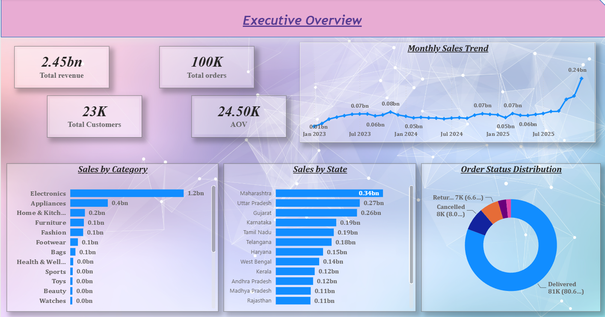
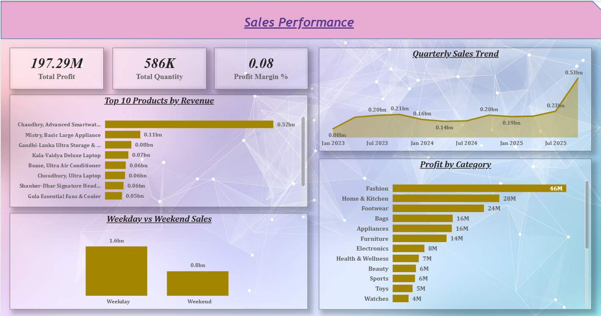
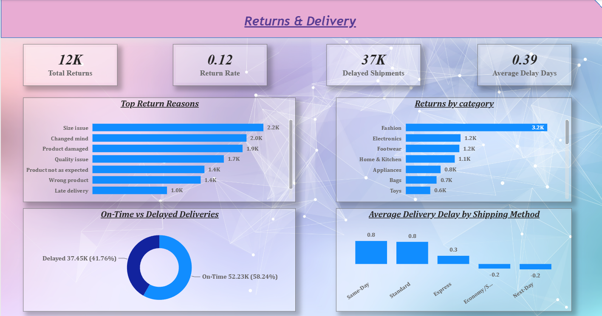
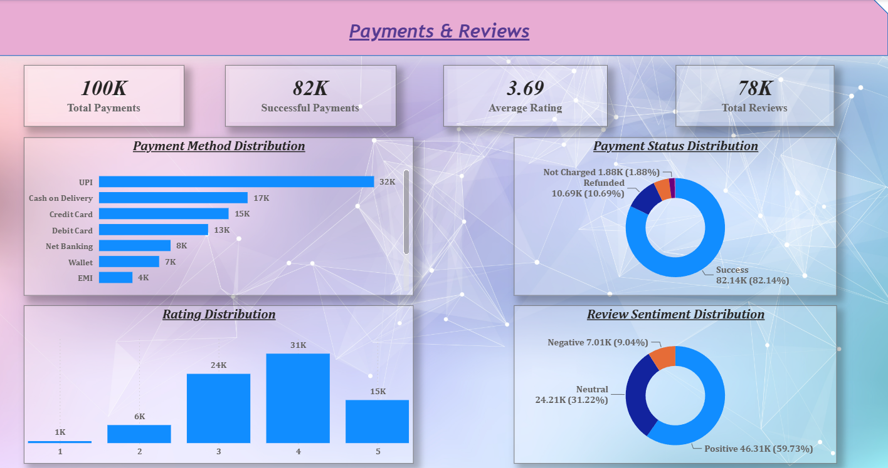

# Indian-E-commerce-Sales-and-Customer-Analytics

A complete End-to-End data Analytics Project Using on **SQL (PostgreSQL) + Python + Power BI**

---

## Project Overview:

This project analyzes a large synthetic Indian E-Commerce dataset containing **100,000+ orders**, **25,000 customers**, and **550 products** across 2023–2025.

The goal is to perform complete data analysis from raw data to actionable business insights using SQL, Python, and Power BI.

---

## Tech Stack:

- **SQL (PostgreSQL)** → Database design, data loading, data quality checks & analytical queries
- **Python (Pandas, NumPy, Matplotlib, Seaborn)** → Data cleaning, feature engineering, EDA & RFM segmentation
- **Power BI** → Interactive dashboards and business insights

---
## Project Structure:

```text
Indian-Ecommerce-Sales-Customer-Analytics/
│
├── README.md
├── requirement.txt
├── .gitignore
│
├── data/
│   ├── raw_data/               # Original dataset from Kaggle
│   └── processed/              # Cleaned data + Master table + RFM segments
│
├── sql/
│   ├── 01_create_schema.sql
│   ├── 02_load_data_and_quality_checks.sql
│   └── 03_analytical_queries.sql
│
├── notebooks/
│   ├── 01_Initial_Data_Profiling.ipynb
│   ├── 02_Data_Cleaning_Feature_Engineering.ipynb
│   ├── 03_EDA_and_Sales_Analysis.ipynb
│   ├── 04_Customer_Segmentation_RFM.ipynb
│   ├── 05_Returns_Delivery_Analysis.ipynb
│   └── 06_Final_Insights_Summary.ipynb
│
├── power_bi/
│   ├── Ecommerce_Analytics_Dashboard.pbix
│   └── screenshots/                                          # Screenshots of all 5 pages
│
└── reports/
    └── Business_Insights_Report.md

```
## Dataset:
Source: [Kaggle - Indian E-Commerce Sales & Customer Analytics](https://www.kaggle.com/datasets/shiyalkishan01/indian-e-commerce-sales-and-customer-analytics)

Tables used:

- customers
- products
- orders
- order_items
- payments
- shipments
- returns
- customer_reviews


---

## Project Workflow:

1. **Initial Data Profiling (Python)**

    Understood structure, data types, missing values, and basic statistics.

2. **Database Design (PostgreSQL)**
   
    Created schema with proper Primary Keys and Foreign Keys.
   
3. **Data Loading**
   
    Loaded CSV files into PostgreSQL using psql and \copy command.
   
4. **Data Quality Checks (SQL)**
   
    Checked nulls, duplicates, referential integrity, and basic business rules.
   
5. **Data Cleaning & Feature Engineering (Python)**
   
   Handled missing values and created new features such as:
    - Time-based features (Year, Month, Quarter, Weekday)
    - Delivery delay days
    - Profit margin
    - Customer tenure
    - has_returned flag

6. **Exploratory Data Analysis (Python)**

    Analyzed sales trends, category performance, geography, and profitability.
   
7. **Customer Segmentation(RFM) (Python)**
   
    Created customer segments: Champions, Loyal, At Risk, Lost, etc.
   
8. **Returns & Delivery Analysis (Python)**
   
    Analyzed return reasons and delivery performance.
   
9. **Power BI Dashboard**
    
    Built an interactive 5-page dashboard:
      - Executive Overview
      - Sales Performance
      - Customer Analytics (RFM)
      - Returns & Delivery
      - Payments & Reviews

10 . **Business Insights & Recommendations**

---

## Power BI Dashboard: 

### Page 1: Executive Overview

### Page 2: Sales Performance

### Page 3: Customer Analytics (RFM)
.png)
### Page 4: Returns & Delivery

### Page 5: Payments & Reviews

---
## How to Setup & Run:

  **1. Clone the repository:**
  ```bash
     git clone https://github.com/Rohit-Bansode/Indian-E-commerce-Sales-and-Customer-Analytics.git
     cd Indian-Ecommerce-Sales-Customer-Analytics
  ```
  **2. Install Python libraries:**
  ```bash
      pip install -r requirement.txt
  ```
  **3. Setup Postgresql:**
  
  - Create a database (example:`indian_ecommerce`)
  - Run `01_create_schema.sql`
  - Load data using `psql` and `\copy` command
  - Run data quality checks and analytical queries

  **4. Run Python Notebooks:**
  
   Run the notebooks in order from `01` to `06`.

  **5. Open PowerBI Dashboard:**
  
  Open the `.pbix` file from the `power_bi/` folder.

---

## Key Insights:

  - Identified top-performing categories, products, and states
  - Created RFM-based customer segments for targeted marketing
  - Analyzed return reasons and delivery delays
  - Evaluated payment methods and customer satisfaction (reviews)
    
---

## Author :

**Rohit Bansode**

<u>Aspiring Data Analyst</u>

- Github : https://github.com/Rohit-Bansode
- Linkedin : https://www.linkedin.com/in/rohit-bansode-0861b8276
- Email : rohitbansode924@gmail.com
      
